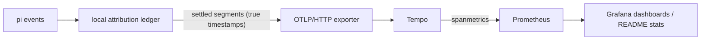

# pi-usage

Coding-time observability for the [pi](https://pi.dev) coding agent, in WakaTime semantics but on your own infrastructure: how much effective work time went into which project, which languages, which files — exported as standard OTLP trace spans to any OpenTelemetry backend you run (or rent).

It is deliberately **not** LLM observability. No model names, no token counts, no prompt text, no command text — those belong to tools like Langfuse. pi-usage answers one question: _where did my coding time go?_

## Why pi-usage instead of WakaTime?

pi-usage was inspired by WakaTime, but its AI-focused features felt like overreach for what I actually needed: my LLM observability is already solved by Langfuse, and I wanted a self-hosted, coding-focused metric layer I could compose myself.

- **Want an out-of-the-box solution?** Use WakaTime.
- **Want to compose your own usage metrics from OpenTelemetry?** Use pi-usage.

pi-usage deliberately avoids `gen_ai.*` semantics — it tracks only effective coding time, project, language, and file attribution.

## How it works



1. **Event adaptation** — watches pi's request/turn/tool lifecycle (`before_agent_start`, `turn_start/end`, `tool_call`, `agent_settled`, `ui_prompt_start/end`, …).
2. **Local attribution ledger** — measures _effective work time_ with a monotonic clock, pauses while pi waits on you (dialogs, confirmations), and settles time when edits land:
   - time since the last settlement is attributed to the **files confirmed changed** in that turn, split equally and contiguously (total is conserved, never double-counted);
   - changes are confirmed by **before/after content comparison** taken around the tool call — a "success" result alone proves nothing;
   - time with no resulting modification, and trailing wrap-up time, becomes **app activity**;
   - waiting on the user is excluded entirely.
3. **OTLP export** — each settled segment becomes a span with real start/end timestamps. One pi session = one trace; each user request = a `pi.request` span; attribution segments = `pi.segment` child spans. In a trace waterfall, waits literally show up as gaps — the waterfall is the attribution heuristic's own debugging view.

The ledger is the source of truth; backends are just sinks. The extension speaks plain OTLP/HTTP and is configured only through standard environment variables, so pointing it at Tempo, Jaeger, an OTel Collector, Grafana Cloud, or a throwaway local collector all work the same.

## Span model

| span    | name         | attributes                                                                                                                      |
| ------- | ------------ | ------------------------------------------------------------------------------------------------------------------------------- |
| request | `pi.request` | `coding.request.id`, `coding.project`                                                                                           |
| segment | `pi.segment` | `coding.segment.kind` (`file`/`app`), `coding.project`, `coding.language`, `coding.entity` (relative path), `coding.request.id` |

Resource attributes: `service.name=pi-usage`, `service.version`, `host.name`, `os.type`, plus anything in `OTEL_RESOURCE_ATTRIBUTES`.

Notably absent by design: `gen_ai.*` anything, file contents, command lines, prompt/session text. The ledger never sees them, so they can't leak.

## Configuration

Standard OTel variables, nothing proprietary:

| variable                                            | meaning                                                           |
| --------------------------------------------------- | ----------------------------------------------------------------- |
| `OTEL_EXPORTER_OTLP_ENDPOINT`                       | base URL, e.g. `http://localhost:4318` (`/v1/traces` is appended) |
| `OTEL_EXPORTER_OTLP_TRACES_ENDPOINT`                | full traces URL; wins over the generic one                        |
| `OTEL_EXPORTER_OTLP_HEADERS` / `..._TRACES_HEADERS` | `key=value,key2=value2` (e.g. `authorization=Basic …`)            |
| `OTEL_RESOURCE_ATTRIBUTES`                          | extra resource attributes, same format                            |

pi-usage specific:

| variable              | default                                       | meaning                                                                    |
| --------------------- | --------------------------------------------- | -------------------------------------------------------------------------- |
| `PI_USAGE_ENABLED`    | on                                            | `0`/`false`/`off` disables entirely                                        |
| `PI_USAGE_ENTITY`     | `path`                                        | `off` stops sending file paths (language/project still sent)               |
| `PI_USAGE_PROJECT`    | auto                                          | override project name detection (nearest `.jj`/`.git` root, else cwd name) |
| `PI_USAGE_STATE_FILE` | `$XDG_STATE_HOME/pi-usage/pending-spans.json` | crash-safe queue of settled-but-unsent spans                               |

With no endpoint configured the extension is completely inert — it still tracks nothing-to-nowhere, and `/pi-usage` tells you why.

## Reliability

- Sending never blocks event handling; one single-flight drain loop with exponential backoff (1s → 60s) and a 10s request timeout.
- The unsent queue is bounded (2000 spans, oldest dropped) and mirrored to a JSON state file, so a crash loses at most the in-flight ledger — settled spans are replayed next session.
- Shutdown drains with a 5s deadline; leftovers stay on disk. At-least-once delivery: a crash mid-post can replay a batch.

## Trying it out

For the fastest end-to-end smoke test, follow the [OpenObserve local quickstart](examples/openobserve/README.md): it starts a disposable OTLP trace backend with Docker Compose and lets you inspect `pi.request`/`pi.segment` in a browser, without setting up Tempo or Grafana first.

See [`examples/`](examples/) for the OpenObserve quickstart, a ready-to-adapt Tempo config (metrics-generator with the `coding.*` dimensions), and a starter Grafana dashboard. The short version:

```bash
export OTEL_EXPORTER_OTLP_ENDPOINT=http://localhost:4318
pi   # work on something, edit files
```

Then query the spanmetrics output:

```promql
# hours per language over the dashboard range
sum by (coding_language) (
  increase(traces_spanmetrics_latency_sum{service_name="pi-usage", coding_segment_kind="file"}[$__range])
) / 3600
```

Inside pi, `/pi-usage` shows the endpoint, project, session totals and queue state.

## Known limitations (by design, v1)

- Only `edit`/`write`-style tools with explicit paths produce file attribution; a `bash` command that writes files contributes its time to the next confirmed edit or to app activity — arbitrary shell writes are not traced back.
- Waits not surfaced through pi's `ui_prompt` events can't be excluded.
- Time spent investigating before a single-line fix lands on that file — the heuristic accepts this rather than guessing relevance.
- A file changed by you in an editor while pi works on it can be attributed to pi's batch; the observation window is the tool call, not process-level causality.
- Mid-run queued user messages don't split a request boundary; internal retries and compaction recovery correctly do not end one.

## Design documents

The full attribution semantics, invariants and backend trade-offs live in the repository docs: [`docs/pi-usage/design.md`](https://github.com/YewFence/pi-grove/blob/main/docs/pi-usage/design.md).

## License

MIT
